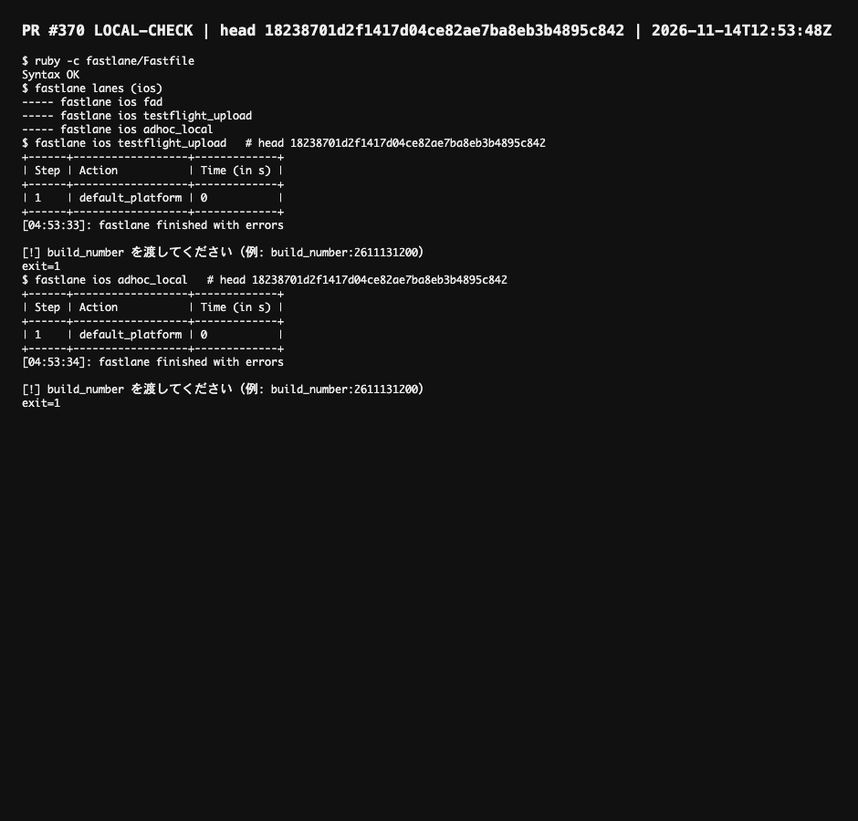

LOCAL-CHECK | head 18238701d2f1417d04ce82ae7ba8eb3b4895c842 | ruby -c; fastlane lanes; fastlane ios testflight_upload; fastlane ios adhoc_local (no build_number) | pass 4 fail 0 | 2026-11-14T13:00Z

Both new lanes stop at their first line without build_number. Nothing was built or uploaded.

https://github.com/kouiso/calendar-alarm/blob/e9a9d7a/evidence/370-1823870.png
