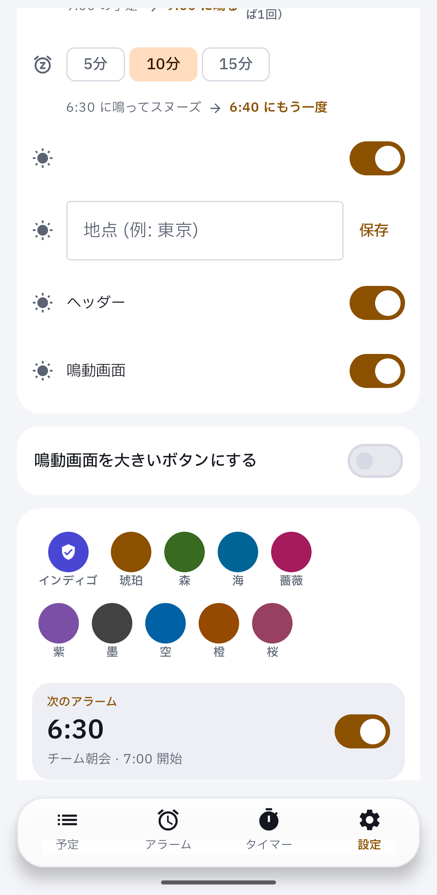
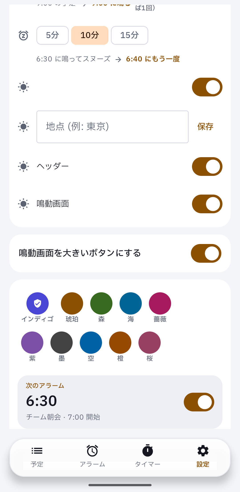

Device evidence for #188 on a real Pixel: the big-button option shows in the appearance card, off and on.

```
DEVICE EVIDENCE | PR #188 | head 506fc3a77980d59f5dd26db941c7b64d1d46c949
build   Android CI run 43602448434 debug APK | versionCode 1 read back
device  Pixel 7 Pro, Android 17, ja-JP, default font and density
mute    zen_mode=2 read back, streams at minimum, nothing rang
board   p154 (cloud lane map); comparison is the reviewer's
not covered  the big-button ringing screen and the stop clip (ringing needs the owner's sound window)
```

| off (default) | on |
|---|---|
|  |  |

The 「チーム朝会 6:30」 card is the app's built-in preview sample, not calendar data.
