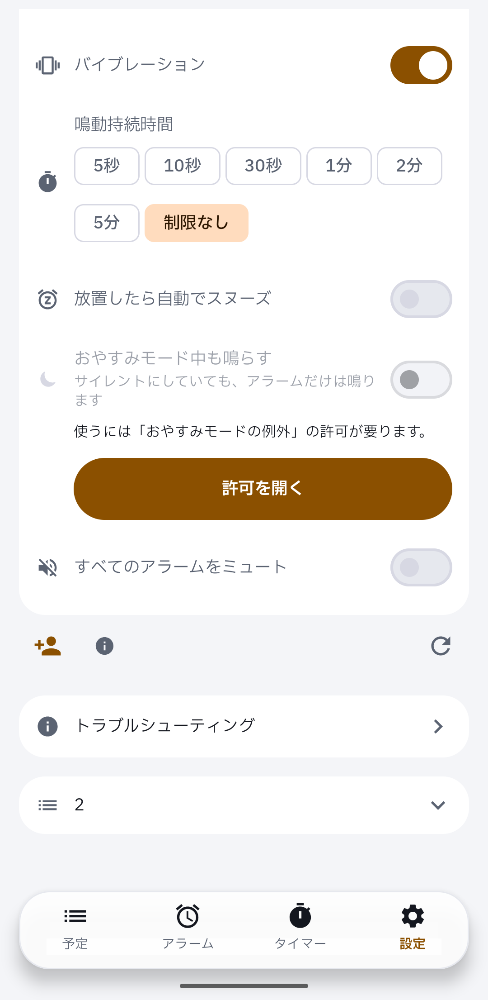

Device evidence for #191 on a real Pixel: without the permission, the switch is disabled and the guidance with 「許可を開く」 shows.

```
DEVICE EVIDENCE | PR #191 | head d68d92e44862617c3c54032f6adaefdb837ae968
build   Android CI run 43602901268 debug APK | versionCode 1 read back
device  Pixel 7 Pro, Android 17, ja-JP, default font and density
mute    zen_mode=2 read back, streams at minimum; dumpsys alarm shows 0 entries for the app, nothing rang
board   p149 (cloud lane map); comparison is the reviewer's
not covered  ringing through Do Not Disturb with the permission granted (audible by design; waits for the owner's sound window); English locale
```


