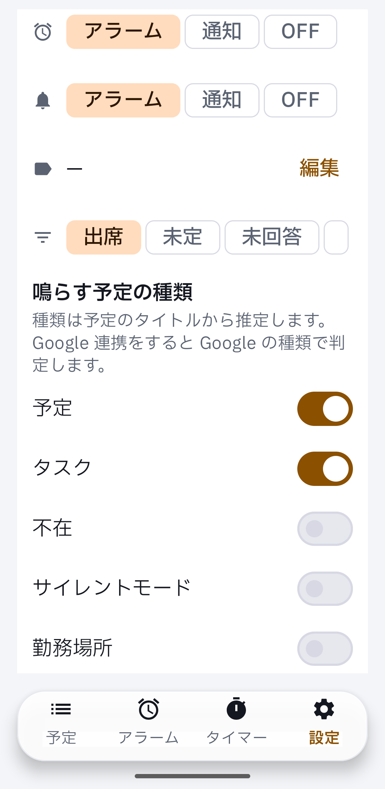
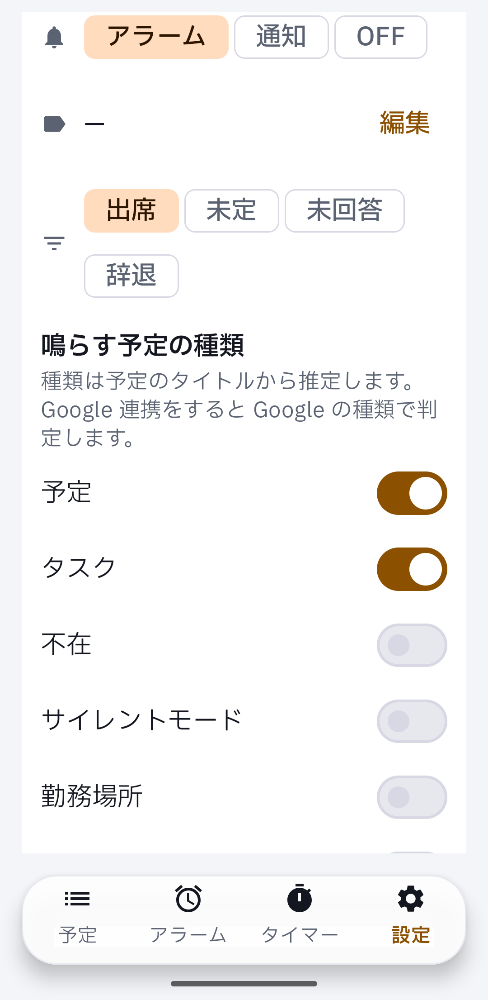

Device evidence for #363 on a real Pixel: the last invite chip now wraps and stays visible.

```
DEVICE EVIDENCE | PR #363 | head 1ef6a65b5a06829a2c9c3e6e1fa638df4ece5c50
build   after: Android CI run 43592017536 debug APK | before: master 216db04, run 43595664932 | versionCode 1 read back
device  Pixel 7 Pro, Android 17, ja-JP, font scale 1.3, width 360dp (density 480), Settings tab, event-rules card
mute    zen_mode=2 read back, streams at minimum, 14:02Z / 14:08Z, nothing rang
board   p155 / d68 settings (cloud lane map); comparison is the reviewer's
not covered  English locale; scroll position close, not pixel-identical
```

| before (master 216db04) | after (1ef6a65) |
|---|---|
|  |  |
