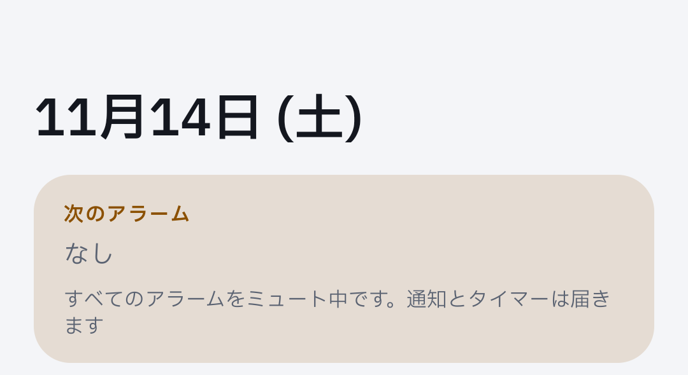
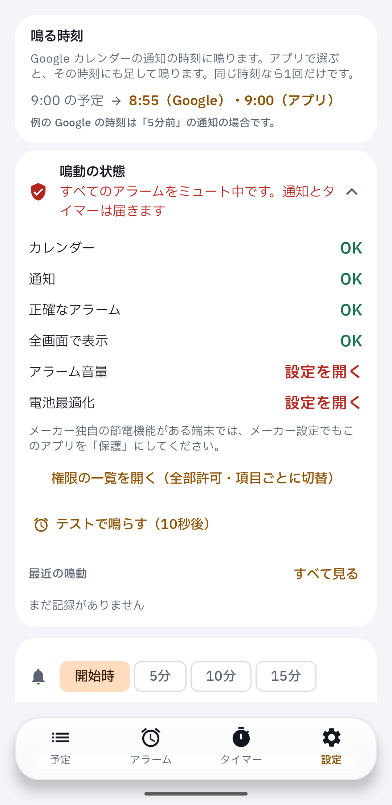
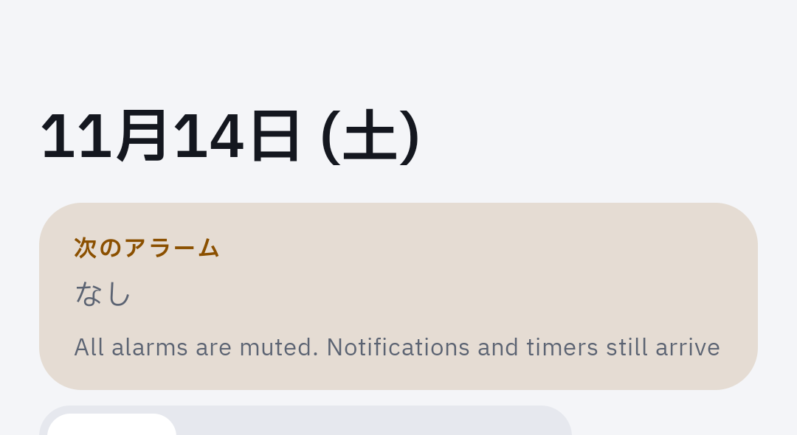
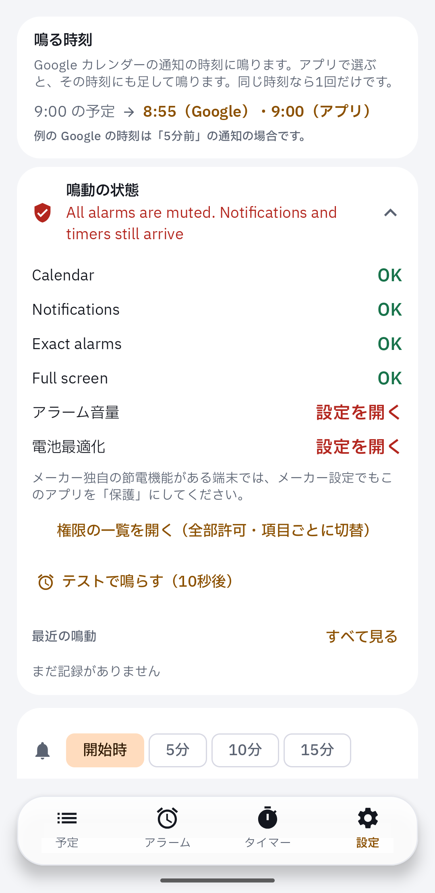

Device evidence for #365 on a real Pixel: the muted status line shows on both screens, in Japanese and English.

```
DEVICE EVIDENCE | PR #365 | head 23ec50d7a60727732808f160de832df40e8e8ea4
build   Android CI run 43591342661 debug APK | versionCode 1 read back
device  Pixel 7 Pro, Android 17, ja-JP and en-US (per-app locale), default font and density
setup   calendar + notification permission granted, "mute all alarms" on in the app
mute    zen_mode=2 read back, streams at minimum, nothing rang
board   d68 home (cloud lane map); comparison is the reviewer's
not covered  agenda header, 次のアラーム and なし stay Japanese in en-US (hard-coded, outside this PR)
```

| | agenda | settings |
|---|---|---|
| ja |  |  |
| en |  |  |
