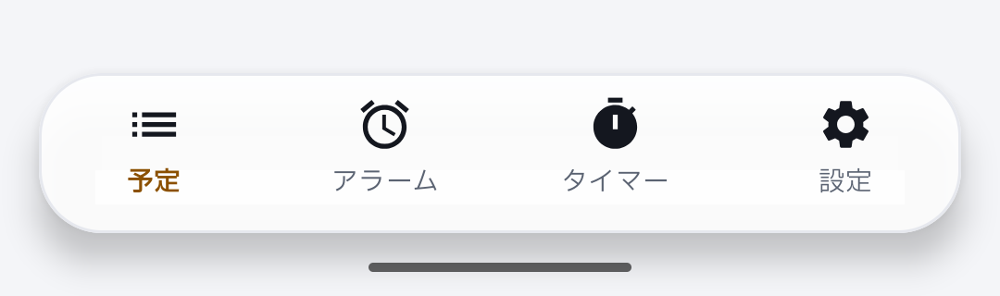
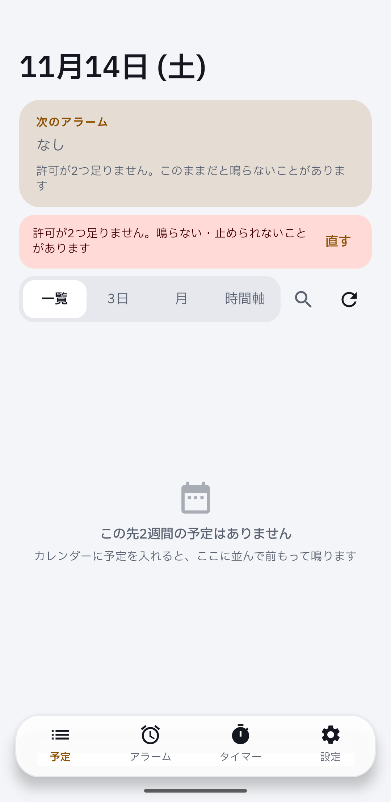
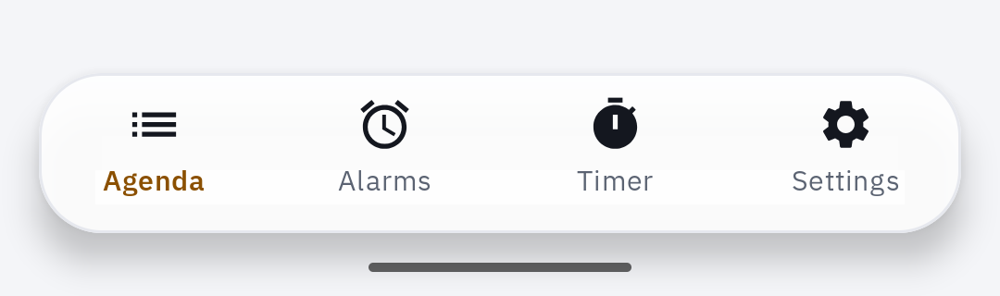
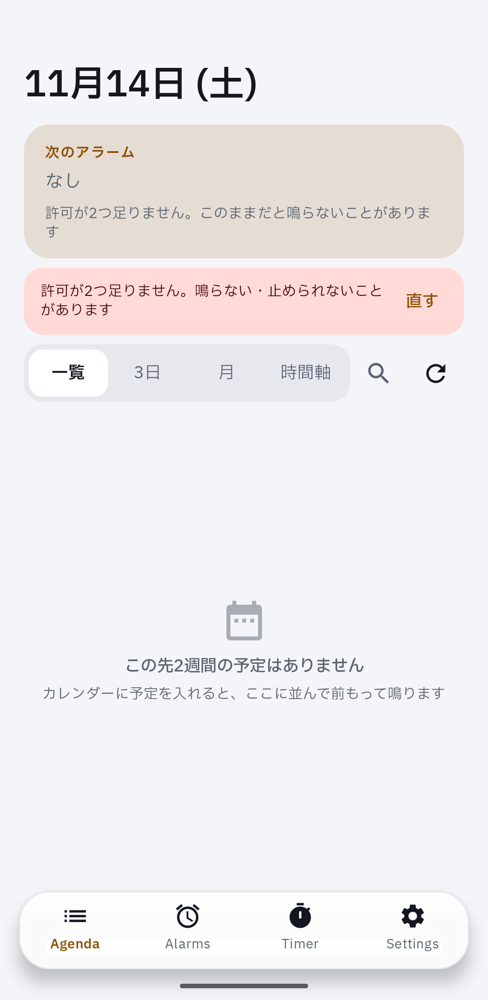

Device evidence for #373 on a real Pixel: the tabs switch to English, but the agenda empty state stays Japanese.

```
DEVICE EVIDENCE | PR #373 | head 1d9fc15f3333fadbfdb969c8f70703a99777b878
build   Android CI run 43594340568 debug APK | versionCode 1 read back
device  Pixel 7 Pro, Android 17, ja-JP and en-US (per-app locale), default font and density
setup   calendar permission not granted, so the agenda is empty
mute    zen_mode=2 read back, streams at minimum, nothing rang
board   d68 tabs / home (cloud lane map); comparison is the reviewer's
found   en-US agenda empty text is Japanese: androidApp/src/main/java/com/calendaralarm/ui/AgendaScreen.kt:275
        still hardcodes "該当する予定はありません" / "この先2週間の予定はありません"
        (the moved agenda_no_events string is used by AgendaViews.kt, not by this screen)
```

| | tabs | agenda |
|---|---|---|
| ja |  |  |
| en |  |  |
